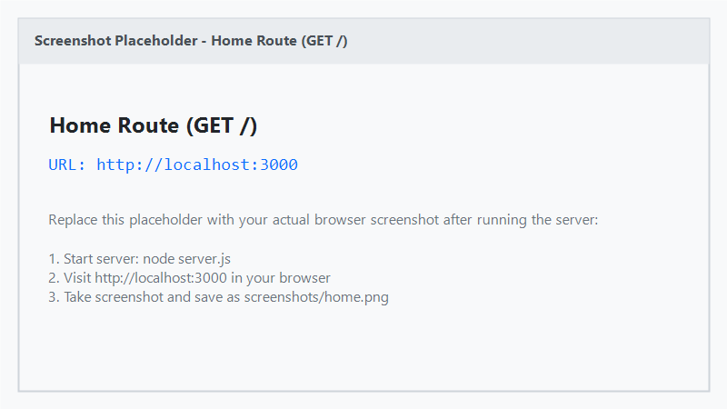
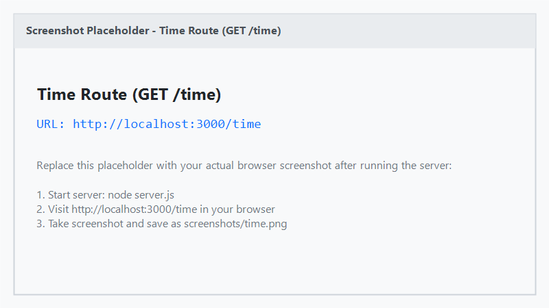
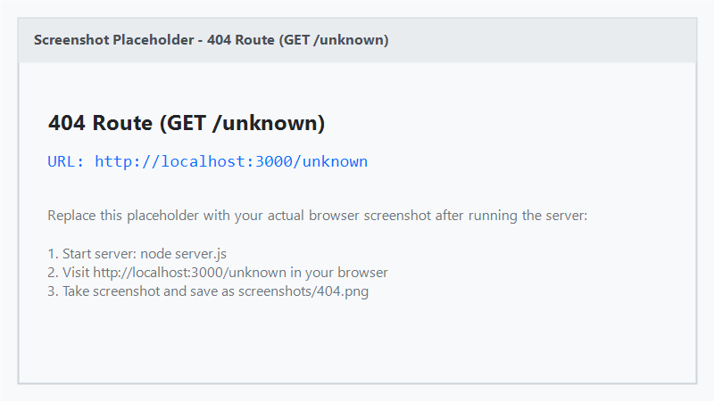

# Lab 1: Node.js and Express server

## Student Information

- **Name:** Yenamala Sreedhar
- **Registration Number:** 252U1R1243
- **Section:** CSE-2E (211)

---

## Live Link

Not deployed yet

Live Link: YOUR_DEPLOYED_URL

---

## Objective

The objective of this lab is to understand the fundamentals of backend web development using Node.js and Express.js. This includes:
1. Setting up a Node.js project using npm.
2. Building a basic HTTP web server using the built-in Node.js `http` module (`plain-server.js`).
3. Creating a web server using the Express.js framework (`server.js`).
4. Defining HTTP GET routes (`/`, `/about`, `/time`) and handling unknown routes with a 404 status code.
5. Implementing server-side status code logging in the terminal.

---

## Technologies Used

- **Node.js**: JavaScript runtime environment for executing JavaScript on the server.
- **Express.js**: Fast, minimalist web framework for Node.js.
- **JavaScript**: Core programming language using CommonJS module syntax (`require`).
- **npm**: Node Package Manager for managing project dependencies.

---

## Project Structure

```text
lab-01/
│
├── screenshots/
│   ├── home.png         # Screenshot of GET /
│   ├── about.png        # Screenshot of GET /about
│   ├── time.png         # Screenshot of GET /time
│   └── 404.png          # Screenshot of unknown route (404)
│
├── plain-server.js      # Basic HTTP server using Node's built-in 'http' module
├── server.js            # Express server with routes, 404 handler, and logging
├── package.json         # Project manifest listing metadata and dependencies
├── package-lock.json    # Records exact dependency versions installed
├── .gitignore           # Specifies files and folders Git should ignore
└── README.md            # Lab documentation and viva preparation guide
```

### Explanation of Core Files and Folders:

- **`package.json`**: The central configuration file for any Node.js project. It contains project metadata (name, version, scripts) and lists the external packages (like `express`) required by the application.
- **`node_modules/`**: The directory generated by npm where all downloaded third-party packages and their dependencies are stored locally. It is large and should never be committed to Git.
- **`plain-server.js`**: Demonstrates how to create a basic web server without third-party frameworks using Node's built-in `http.createServer()`.
- **`server.js`**: The main Express server file demonstrating routing (`app.get`), middleware logging, and 404 error handling.
- **`.gitignore`**: Tells Git to ignore folders and files like `node_modules/` and `.env` so they are not pushed to the repository.

---

## Installation

1. Navigate to the `lab-01` directory:
   ```bash
   cd lab-01
   ```

2. Install project dependencies:
   ```bash
   npm install
   ```

---

## How to Run

### 1. Running the Express Server (Primary)

Start the Express application:
```bash
node server.js
```
or via npm script:
```bash
npm start
```

The server will start and print:
```text
Server running at http://localhost:3000
```

### 2. Running the Plain Node.js HTTP Server

To test the built-in Node.js HTTP server:
```bash
node plain-server.js
```

The server will print:
```text
Server running at http://localhost:3000
```
*(Remember to stop one server before starting another on the same port).*

---

## Endpoints

| Method | Path | Description | Status |
| :--- | :--- | :--- | :--- |
| GET | `/` | Welcome message | 200 |
| GET | `/about` | Returns name and section as JSON | 200 |
| GET | `/time` | Returns current date and time | 200 |
| GET | `/unknown` | Demonstrates 404 handling | 404 |

### Status Code Logging

When routes are accessed, the server terminal logs the request method, path, and HTTP status code:
- `GET / - 200`
- `GET /about - 200`
- `GET /time - 200`
- `GET /unknown - 404`

---

## Screenshots

> *Note: Placeholder images are provided. Run the server locally, open the URLs in your browser, take screenshots, and replace the files in the `screenshots/` directory.*








---

## Viva Questions

### 1. What is Node.js?
Node.js is an open-source, cross-platform JavaScript runtime environment built on Google Chrome's V8 engine that allows developers to run JavaScript code on the server side (outside the browser).

### 2. What is Express.js?
Express.js is a minimal and flexible web application framework for Node.js. It simplifies building web servers by providing built-in routing, middleware support, and easy request/response handling.

### 3. What is package.json?
`package.json` is the manifest and configuration file of a Node.js project. It stores project metadata (name, version), scripts, and lists the external dependencies required by the project.

### 4. What is node_modules?
`node_modules` is the directory where npm downloads and installs all third-party libraries and dependencies listed in `package.json`.

### 5. Difference between package.json and node_modules?
- `package.json` is a lightweight configuration text file that records *which* packages and versions the project needs. It is tracked in Git.
- `node_modules` is the heavy folder containing the actual downloaded source code of those packages. It is ignored in Git and can be recreated at any time by running `npm install`.

### 6. What does app.listen() do?
`app.listen(PORT, callback)` binds and listens for incoming HTTP connections on the specified port number (e.g., 3000). Once the server starts successfully, it executes the callback function.

### 7. What are request and response?
- **Request (`req`)**: An object representing the incoming HTTP request from the client, containing data such as the requested URL, HTTP method, headers, and query parameters.
- **Response (`res`)**: An object representing the outgoing HTTP response sent by the server, used to send status codes, headers, and data (like text or JSON) back to the client.

### 8. What is an HTTP GET request?
An HTTP GET request is an HTTP method used by clients to retrieve or fetch data from a specified resource on a server. It should only retrieve data and not alter the server's state.

### 9. What is status code 200?
HTTP Status Code 200 stands for "OK". It indicates that the client's HTTP request was successfully received, understood, and processed by the server.

### 10. What is status code 404?
HTTP Status Code 404 stands for "Not Found". It indicates that the server cannot find the requested resource or route matching the client's URL.

### 11. Why do we use new Date()?
`new Date()` is a built-in JavaScript constructor that creates a Date object initialized to the current date and time according to the system clock.

### 12. What does app.get() do?
`app.get(path, handler)` is an Express routing method that listens for HTTP GET requests matching the specified URL path and invokes the handler function `(req, res)` to process and respond to the request.

### 13. Why do we use express()?
`express()` is the top-level factory function exported by the Express library. Calling `express()` initializes and creates an instance of the Express application (`app`), which provides the methods to configure routing, middleware, and start the server.

### 14. What is npm?
npm (Node Package Manager) is the default package manager for Node.js. It allows developers to install, share, update, and manage third-party code packages and dependencies in their projects.

---

## Notes / Problems Faced

### Potential Issue: Port 3000 Already in Use
- **Problem**: When starting the server (`node server.js` or `node plain-server.js`), an error `EADDRINUSE: address already in use :::3000` may occur if another process or a previously running server instance is using port 3000.
- **Solution**: Terminate the existing process running on port 3000 or change the `PORT` variable in the code (e.g., `const PORT = 3001;`) before restarting the server.
